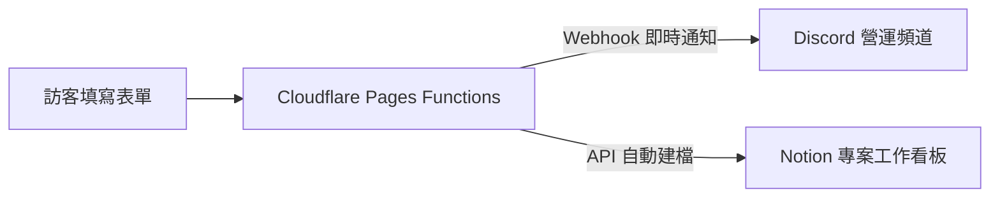

> **📌 站長說明**：  
> 本篇專門紀錄與拆解**實際營運站點所搭載的行銷自動化全功能**。  
> 目前您所瀏覽的這個「求職作品集站點」為純靜態、去識別化的展示版本（Demo Shell），旨在展現前端排版與 Technical SEO 成果；後端 Webhook 與外部 API 金鑰並未暴露於此開源 Repo 中。

---

## 前言：打造零維運成本的 MarTech 工作流

身為專注於內容與 SEO 的行銷人，在缺乏大型工程團隊支援的情況下，如何建立一套**穩定、低成本且完全自動化**的行銷營運流程？

在正式營運的站點中，我結合了輕量化雲端邊緣服務（Cloudflare Pages Functions）與既有 SaaS 工具（Discord、Notion、Zoho），打造了一套不需要自架伺服器的自動化工作流。

---

## 一、互動式表單與邊緣 Webhook 自動化

傳統行銷表單若使用 Google Forms 嵌入，常破壞網站一致的視覺調性；若自架後端伺服器接收資料，又需要負擔主機租金與資安維護。

### 正式版的解決方案：
1. **客製化表單前端**：使用 React 與新粗獷主義（Neo-Brutalism）打造原生體驗表單，兼顧視覺張力與欄位驗證。
2. **邊緣處理函式（Cloudflare Pages Functions）**：
   - 訪客送出表單時，請求發送至邊緣節點（`/api/commission`）。
   - 由邊緣函式進行資料安全校驗，執行非同步分流派發：
     - **即時通知**：觸發 **Discord Webhook**，將諮詢即時推播至管理員手機，確保第一時間回覆潛在需求。
     - **專案看板同步**：呼叫 **Notion API**，自動在工作看板中新增一筆結構化任務卡片，省去人工謄寫時間。

---

## 二、低成本電子報訂閱與使用者體驗平衡

內容行銷的核心資產在於**第一方名單（First-Party Data）**。為了維持與讀者的長期連結，正式站點導入了電子報訂閱機制：

1. **整合 Zoho Campaigns**：相較於昂貴的行銷工具，Zoho 提供了高性價比的名單管理與自動歡迎信寄送功能。
2. **使用者體驗細節（避免彈窗騷擾）**：
   - 拒絕進入網站就彈出阻擋畫面的惱人 Pop-up。
   - 改採在首頁設計具備呼吸燈效果的「訂閱提醒紅點（Dot Notification）」。
   - 透過瀏覽器 `localStorage` 記住訪客狀態：當讀者點擊或訂閱後，紅點自動在全站消除且跨頁面不再重複提示，在**名單轉換率**與**閱讀舒適度**之間取得最佳平衡。

---

## 三、現代搜尋與 AI 檢索支援（Search & AI Optimization）

除了傳統 Google 搜尋引擎外，正式站點也針對生成式 AI（如 ChatGPT Search、Perplexity）進行了檢索最佳化：

- **動態 XML Sitemap**：建置時自動爬梳所有文章與發布日期，自動生成 Sitemap Index 供搜尋引擎第一時間抓取。
- **動態 Open Graph 社群卡片**：每篇文章均配置專屬的 `og:title`、`og:description` 與預覽圖，確保在社群轉貼時享有最高的點擊率（CTR）。
- **支援 `llms.txt` 規範**：在根目錄配置標準化 Markdown 內容摘要檔，讓大語言模型能夠快速、低消耗地理解站點主題與內容關聯。

---

## 結語

這套工作流的建立，證明了即使沒有龐大預算或後端工程團隊，行銷人依然能透過理解 API、Webhook 與前端元件，組合出極具效率的自動化 MarTech 系統。
