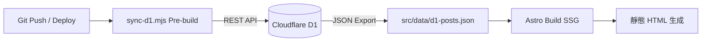

## 前言：現代 Web 開發的邊緣運算範式

在無伺服器（Serverless）時代，我們不再需要租用高昂的虛擬主機或常駐運行的 Node.js 執行個體。透過 **Cloudflare Pages** 與 **Pages Functions**，所有靜態資源與後端 API 端點均部署在全球超過 300 個邊緣節點（Edge Nodes），實現近乎零延遲的全球分發。

---

## 一、邊緣 API 路由架構（Edge Functions）

本站的聯絡表單與合作洽詢系統，由位於 `functions/api/commission.ts` 的邊緣函式負責處理：

```typescript
// functions/api/commission.ts
export async function onRequestPost(context) {
  try {
    const { env, request } = context;
    const data = await request.json();

    // 取得環境變數與金鑰（由 Cloudflare 控制台安全注入）
    const NOTION_TOKEN = env.NOTION_TOKEN;
    const DISCORD_WEBHOOK_URL = env.DISCORD_WEBHOOK_URL;

    // 1. 資料驗證與型別檢查
    const clientName = data.nickname || "匿名訪客";
    const contact = data.contact;
    const inquiryType = data.commissionType;

    // 2. 邊緣非同步分流：將諮詢轉發至 Discord Webhook 與 Notion 專案庫
    await Promise.all([
      sendDiscordNotification(DISCORD_WEBHOOK_URL, data),
      syncToNotionDatabase(NOTION_TOKEN, data)
    ]);

    return new Response(JSON.stringify({ result: "success" }), {
      headers: { "Content-Type": "application/json" }
    });
  } catch (err) {
    return new Response(JSON.stringify({ result: "error", message: err.message }), {
      status: 500,
      headers: { "Content-Type": "application/json" }
    });
  }
}
```

### 架構優勢：
- **冷啟動時間近乎為 0**：基於 V8 Isolates，冷啟動延遲低於 5ms，遠勝傳統 Docker 容器或 AWS Lambda。
- **免維護維運**：自動擴展彈性，流量突增亦無須擔心伺服器承載能力。

---

## 二、建置期資料同步機制（Build-time Sync Pipeline）

為了兼顧動態內容更新與靜態網站生成（SSG）的頂級讀取效能，本專案在 `scripts/sync-d1.mjs` 設計了一道 Pre-build Hook：



透過這套管線：
1. 建置腳本在編譯前自動查詢資料庫中的發布內容。
2. 匯出為靜態 JSON 快取檔供 Astro 在打包期（SSG）直接引用。
3. 產生零延遲、百分之百快取友善的靜態 HTML 頁面。

---

## 三、總結

此套「前端靜態托管 + 邊緣函式路由 + 自動化同步管線」的組合，展現了當前雲端邊緣架構（Edge Computing）的最佳實踐：用極低甚至零維運成本，建構出企業級可靠度的高效能 Web 應用。

